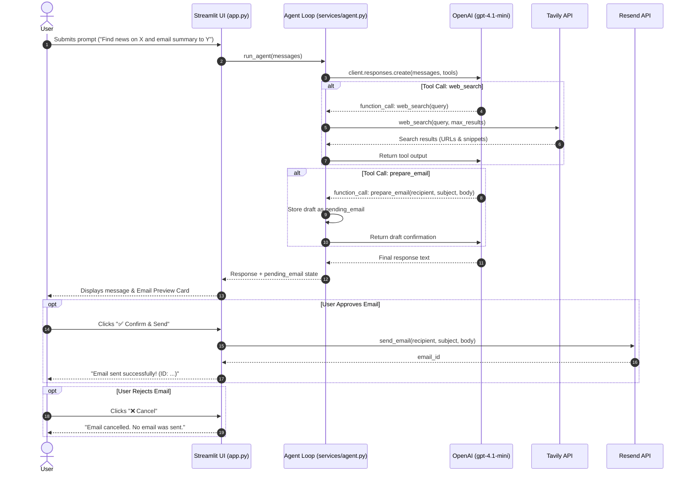

# 🤖 Tool-Calling AI Chatbot

An intelligent conversational AI chatbot built with **Python**, **Streamlit**, and **OpenAI's Responses API**. The chatbot features autonomous multi-round **Tool / Function Calling** capabilities with built-in safety guardrails (**Human-in-the-Loop**) for sensitive actions like sending emails.

---

## 📑 Table of Contents

- [Overview](#-overview)
- [Key Features](#-key-features)
- [Integrated Tools & Services](#-integrated-tools--services)
  - [1. Tavily AI (Real-time Web Search)](#1-tavily-ai-real-time-web-search)
  - [2. Resend (Email Service with Human-in-the-Loop)](#2-resend-email-service-with-human-in-the-loop)
  - [3. OpenAI Model & Function Calling](#3-openai-model--function-calling)
- [Project Architecture & Directory Structure](#-project-architecture--directory-structure)
- [How It Works (Workflow)](#-how-it-works-workflow)
- [Environment Configuration](#-environment-configuration)
- [Installation & Setup Commands](#-installation--setup-commands)
- [Running the Application](#-running-the-application)
- [Development & Git Commands Log](#-development--git-commands-log)

---

## 🌟 Overview

Standard LLMs are limited by knowledge cutoffs and cannot interact with external services directly. This project implements a **Tool-Calling Agent** that bridges the LLM with external APIs:

- Need up-to-date facts or live web results? The agent calls the **Tavily Web Search** tool.
- Need to send an email? The agent drafts the message with the **prepare_email** tool and presents an interactive preview in Streamlit. The email is dispatched via **Resend** only after the user reviews, optionally edits, and explicitly confirms it.

---

## ✨ Key Features

- **Multi-Round Tool Execution Loop**: Handles complex queries requiring sequential tool interactions (up to 5 rounds) using OpenAI's Responses API.
- **Real-Time Web Search**: Integrates Tavily AI to fetch up-to-date internet research, news, and live data with source attribution.
- **Human-in-the-Loop (HITL) Email Safety**: Strict policy ensuring the AI never sends emails autonomously. It prepares a draft, renders an editable UI form in Streamlit, and requires one-click user authorization.
- **Interactive Streamlit Web UI**: Clean, responsive interface featuring message history, real-time loading spinners, and dynamic input cards.
- **Type-Safe Strict JSON Tool Schemas**: Tool parameters enforce `strict: True` and explicit schemas for predictable, error-free model invocations.

---

## 🛠 Integrated Tools & Services

### 1. Tavily AI (Real-time Web Search)

- **Library**: `tavily-python`
- **Purpose**: Search the live web for current events, technical documentation, or information beyond the model's training cutoff.
- **Implementation**: Located in [`tools/web_search.py`](tools/web_search.py).
- **Parameters**:
  - `query` (_string_, required): Search term or question.
  - `max_results` (_integer_, required): Maximum number of top web results to return (default: `5`).
- **Output**: Returns a curated list of results containing `title`, `url`, `content`, and relevance `score`.
- **System Instructions**: The model is instructed to cite relevant source URLs and avoid fabricating search results.

### 2. Resend (Email Service with Human-in-the-Loop)

- **Library**: `resend`
- **Purpose**: Reliably dispatch transactional emails.
- **Implementation**:
  - **Drafting Tool**: [`tools/email_tools.py`](tools/email_tools.py) (`prepare_email`) creates an `awaiting_confirmation` payload containing recipient, subject, and body.
  - **Delivery Service**: [`services/email_service.py`](services/email_service.py) (`send_email`) calls `resend.Emails.send()` strictly upon user button click.
- **Security & Safety Guardrails**:
  1. The LLM has access _only_ to `prepare_email`, never to direct send execution.
  2. Prompts strictly forbid the agent from claiming an email was sent before explicit confirmation.
  3. Streamlit renders an interactive review card allowing the user to edit the recipient, subject, or message body, or cancel the action entirely.

### 3. OpenAI Model & Function Calling

- **Library**: `openai` (v3+ Responses API)
- **Default Model**: `gpt-4.1-mini` (configurable via `OPENAI_MODEL`)
- **Implementation**: Located in [`services/agent.py`](services/agent.py) and [`services/tool_definitions.py`](services/tool_definitions.py).
- **Flow**: Sends messages and tool schemas to `client.responses.create()`, parses `function_call` outputs, dispatches matching local Python functions, and feeds results back in a loop.

---

## 📂 Project Architecture & Directory Structure

```text
Tool-Calling-AI-Chatbot/
│
├── .env                     # Private environment variables (API keys)
├── .env.example             # Template environment variables
├── .gitignore               # Git ignored patterns (.env, .venv, caches)
├── .python-version          # Python runtime version pin (>=3.14)
├── pyproject.toml           # Project metadata & dependencies
├── uv.lock                  # UV dependency lockfile
├── README.md                # Project documentation
├── app.py                   # Streamlit main application & UI logic
│
├── services/
│   ├── __init__.py
│   ├── agent.py             # Agent runtime loop & function dispatcher
│   ├── email_service.py     # Resend email API integration
│   └── tool_definitions.py  # Strict JSON schemas for OpenAI tools
│
└── tools/
    ├── __init__.py
    ├── email_tools.py       # Email draft preparation logic
    └── web_search.py        # Tavily search API client wrapper
```

---

## 🔄 How It Works (Workflow)



---

## ⚙️ Environment Configuration

Create a `.env` file in the root directory by copying from `.env.example`:

```bash
cp .env.example .env
```

Set your API credentials in `.env`:

| Variable            | Description                     | Required | Example / Default       |
| :------------------ | :------------------------------ | :------: | :---------------------- |
| `OPENAI_API_KEY`    | OpenAI API Secret Key           | **Yes**  | `sk-proj-...`           |
| `OPENAI_MODEL`      | OpenAI Model Name               |    No    | `gpt-4.1-mini`          |
| `TAVILY_API_KEY`    | Tavily Search API Key           | **Yes**  | `tvly-...`              |
| `RESEND_API_KEY`    | Resend API Key                  | **Yes**  | `re_...`                |
| `RESEND_FROM_EMAIL` | Verified sender email in Resend | **Yes**  | `onboarding@resend.dev` |

> [!NOTE]
> For Resend testing without a custom domain, you can use `onboarding@resend.dev`. Note that in test mode, Resend permits sending emails only to your account's registered email address until a domain is verified.

---

## 💻 Installation & Setup Commands

This project is managed using modern Python tooling ([uv](https://github.com/astral-sh/uv)) or standard `pip`.

### Option A: Using `uv` (Recommended)

1. **Clone the repository:**

   ```bash
   git clone <repo-url>
   cd Tool-Calling-AI-Chatbot
   ```

2. **Sync dependencies:**
   ```bash
   uv sync
   ```
   _(Or if creating from scratch)_:
   ```bash
   uv venv
   uv add openai python-dotenv resend streamlit tavily-python
   ```

### Option B: Using standard Python `venv` and `pip`

1. **Create and activate a virtual environment:**
   - **Windows:**
     ```powershell
     python -m venv .venv
     .venv\Scripts\activate
     ```
   - **macOS / Linux:**
     ```bash
     python3 -m venv .venv
     source .venv/bin/activate
     ```

2. **Install dependencies:**
   ```bash
   pip install openai python-dotenv resend streamlit tavily-python
   ```

---

## 🚀 Running the Application

Launch the Streamlit web application:

Using `uv`:

```bash
uv run streamlit run app.py
```

Or using an activated virtual environment:

```bash
streamlit run app.py
```

The application will start and open automatically in your browser at:

```text
http://localhost:8501
```

---
